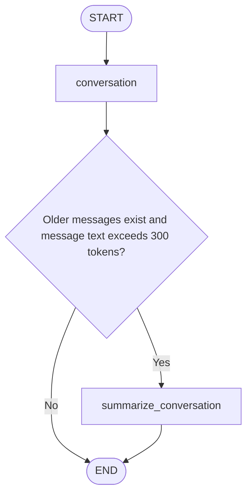

# Summarization Memory Agent with LangGraph

A Python CLI demonstration of rolling conversational memory for a synthetic cloud-support incident. The agent keeps a summary of earlier exchanges and a small recent-message window, allowing facts and explicit corrections to remain available after older messages leave active state.

**Author:** [Victor Pereira](https://pereiravictor.com/)  
**Repository:** [vpereira3000/summarization-memory-agent](https://github.com/vpereira3000/summarization-memory-agent)  
**Recommended entry point:** `summarization_memory_agent_reviewed.py`

This is an educational prototype. Summary accuracy and generated source references are not guaranteed. The assistant has no infrastructure tools and does not execute its proposed diagnostic checks.

## What it demonstrates

- LangGraph state extended with a running `summary`.
- Conditional summarization based on a message-text token estimate.
- `RemoveMessage` updates applied through the `MessagesState` reducer.
- Thread continuity using `InMemorySaver` within one running process.
- Prompts that distinguish reported observations, hypotheses, proposals, and user-reported completed work.
- Explicit correction handling and recall after pruning.
- Reduced-state message counts printed after each turn.

## Repository files

| File | Role |
| --- | --- |
| `summarization_memory_agent_reviewed.py` | Recommended implementation used in the reviewed live demonstration |
| `requirements.txt` | Direct Python dependencies |
| `.env.example` | Placeholder configuration; contains no real API key |
| `.gitignore` | Excludes credentials, environments, caches, and local output |
| `README.md` | Setup, usage, architecture, observations, and limitations |
| `architecture_graph_reviewed.png` | Optional generated graph illustration |
| `summarization_memory_agent.py` | Optional baseline for comparing behavior; not the recommended entry point |

The list above describes the intended repository layout. Add the support files below if they are not present yet. Keep the unpublished blog draft outside the public repository until it is ready for release. Do not include unrelated agents from a shared development folder.

## Requirements

- Python 3.11 or newer; the author's live Windows demonstration used Python 3.14.6.
- Git, if cloning the repository.
- An OpenAI API key with access to the configured model, `gpt-4o`.
- Internet connectivity for model calls and optional graph rendering.

API calls can incur charges. The complete resolved dependency set from the author's Windows demonstration has not yet been captured; the requirements below are minimum constraints rather than a verified lockfile.

Use this `requirements.txt` for the reviewed script:

```text
langgraph>=1.0,<2
langchain-openai>=1.0,<2
langchain-core>=1.0,<2
python-dotenv>=1.0.1,<2
tiktoken>=0.7.0,<1
```

`langchain-core` is listed explicitly because the script imports it directly. The script does not directly use Pillow or grandalf. Graph image generation is optional and its failure does not stop the CLI.

## Quick start: Windows PowerShell

After the source files have been uploaded to this repository:

```powershell
git clone https://github.com/vpereira3000/summarization-memory-agent.git
cd summarization-memory-agent
python -m venv .venv
.\.venv\Scripts\python.exe -m pip install -r requirements.txt
Copy-Item .env.example .env
```

Edit `.env` locally and replace the placeholder with your own key:

```dotenv
OPENAI_API_KEY=replace_with_your_private_key
```

Do not commit `.env` or expose its contents in screenshots. The reviewed script loads `.env` from the directory containing the Python file. Existing process environment variables take precedence under the default dotenv behavior.

Check syntax and launch the agent:

```powershell
.\.venv\Scripts\python.exe -m py_compile summarization_memory_agent_reviewed.py
.\.venv\Scripts\python.exe summarization_memory_agent_reviewed.py
```

In VS Code, select the `.venv` interpreter with **Python: Select Interpreter**, open the reviewed script, and choose **Run Python File**. Enter each message at the `You:` prompt. Keep the same process running throughout a multi-turn test. Type `q`, `quit`, or `exit` to finish.

A fresh process starts with empty memory. Reusing the same thread ID does not recover memory after a process restart with this in-memory checkpointer.

## Architecture



Each user submission starts a new invocation using the same thread configuration. The conversation node answers once. The router then decides whether to summarize; both paths finish at `END`.

`END` finishes the current invocation, not the interactive program. The CLI reads another user message and invokes the graph again. Connecting summarization back to the conversation node would generate another response without new user input and may cause repeated cycling.

The summarizer returns a replacement summary plus removal updates for all but the latest two messages. The message reducer applies these directives to state. They are not ordinary retained conversation messages.

The summary and its supporting messages are supplied as data separate from the summarization policy. The conversation model receives the prior memory note labeled as fallible historical information, outside the system policy. This separation improves clarity but does not guarantee resistance to prompt injection.

## Configuration in the script

| Setting | Default | Meaning |
| --- | --- | --- |
| `MODEL_NAME` | `gpt-4o` | Model configured for both conversation and summarization |
| `TOKEN_THRESHOLD` | `300` | Demo trigger for active message-text tokens |
| `KEEP_MESSAGES` | `2` | Latest user/assistant exchange retained after successful compression |
| Summary word target | `250` | Prompt instruction, not a strict validator |
| Summary token cap | `800` | Rejects an oversized generated summary before pruning |
| `thread_id` | `cloud-support-reviewed-01` | Identifies this conversation within the running process |

The 300-token trigger is deliberately small for observation. It excludes the summary, system policy, JSON memory framing, message overhead, and output allowance. Compression happens **after** the conversational call, so it does not protect that call from an oversized input.

The first turn skips summarization because there is nothing older than the retained exchange to remove, even when its text exceeds 300 estimated tokens.

On a failed, empty, or over-cap summary, the summarization node returns no state update and leaves the existing summary and history intact. Unexpected conversation-call errors still stop execution.

## Try a synthetic incident

First message:

> Our Kubernetes cluster k8s-prod-us-east has intermittent HTTP 504 Gateway Timeout errors through the API gateway. The affected namespace is payments, and the incident ID is INC-DEMO-042. We cannot restart the cluster during business hours. These are synthetic details for a demonstration. Help me investigate step by step, distinguish confirmed facts from hypotheses, and do not assume a root cause.

Second message:

> No diagnostic checks have been performed yet, and I have no logs or measurements to share. Before proceeding, give me only the next two read-only diagnostic checks, explaining what evidence each would collect. Keep all possible causes labeled as untested hypotheses and preserve the operational restriction.

After compression, ask for the incident ID, cluster, namespace, symptom, and restriction without repeating their values. Then test a correction:

> Correction: the incident ID is INC-DEMO-043, not INC-DEMO-042. The namespace is payments-api, not payments. The cluster name, reported HTTP 504 error, and restriction against restarting during business hours remain unchanged. No diagnostic checks or mitigation actions have been performed. State the updated facts only, and mark the old incident ID and namespace as superseded.

For a stronger correction-retention test, continue with a general exchange that omits incident details. Wait until compression removes the correction exchange and the printed active-message count returns to two. Then ask for the current and superseded values without supplying them.

Response lengths vary, so summarization is not guaranteed at a specific turn. Check the printed state instead of assuming pruning occurred.

## Reading the output

```text
[CONTEXT COMPRESSION]
...generated summary...
Removal updates: 2
[State] Active messages: 2
[State] Message-text tokens (estimate): ...
[State] Summary present: True
```

`Removal updates` counts the directives emitted by the summarizer. `Active messages` comes from the resulting checkpoint state. The token estimate covers only those active messages; it does not measure the full model request or establish net cost savings.

## Observed results

The original implementation produced unsupported findings and completed-action claims in its first summary. An explicit correction was acknowledged conversationally but initially failed to repair the summary. A later memory audit repaired it.

In a separate seven-turn reviewed session, the agent preserved the absence of diagnostic evidence, recalled the original incident details, applied corrections, and recalled the corrected values after the correction exchange left active history. The observed active-message counts were `2, 2, 2, 2, 4, 2, 2`; removal-update counts were `0, 2, 2, 2, 0, 4, 2`, where zero means the summarization node was skipped.

Local tests using a simulated model also checked multi-turn termination, one conversation response per turn, pruning, thread isolation, and preservation of history when summarization fails. These mechanical checks do not measure model factual accuracy.

The live runs used different input sequences and multiple implementation changes. They are exploratory observations, not a controlled benchmark or a production reliability claim.

## Known limitations

- Generated source IDs and `PRIOR-NOTE` labels are inconsistent; provenance is not structurally validated.
- Summaries can still omit, distort, or invent facts. Preserve source evidence separately for important workflows.
- The “User-reported observations and results” field can say “None reported” while symptoms appear elsewhere; interpret it as additional diagnostic results, not absence of an incident report.
- In-memory checkpointing does not survive process restarts and is not a durable incident archive.
- Removing messages from current state does not establish deletion from older checkpoints, traces, or provider records.
- Only string message content is supported. The script has no infrastructure tools, retrieval, multimodal input, or tool-call history management.
- Complete input budgeting, measured net cost savings, repeated accuracy evaluations, and validated evidence attribution remain future work.
- CLI execution does not automatically launch LangSmith Studio. Tracing, if enabled separately, may transmit conversation data; use synthetic details.

## Graph image and troubleshooting

The CLI attempts to write `architecture_graph_reviewed.png` beside the script. Rendering may depend on external service availability. A rendering error is caught and the conversation loop continues.

If imports fail, install dependencies using the exact interpreter that runs the script. If API authentication fails, check the local `.env` and model access without sharing the key. If no compression occurs, inspect the active-message count and token estimate; short exchanges can remain below the trigger.

## Support-file templates

Create `.env.example` with a placeholder only:

```dotenv
OPENAI_API_KEY=replace_with_your_private_key
```

Suggested `.gitignore`:

```gitignore
.env
.env.*
!.env.example
.venv/
venv/
__pycache__/
*.py[cod]
.pytest_cache/
.vscode/
.idea/
*.log
architecture_graph.png
```

Do not add a blanket `*.png` exclusion if you want to version the reviewed graph image or selected documentation screenshots. Check your existing ignore rules before uploading.

## References

- [LangGraph memory documentation](https://docs.langchain.com/oss/python/langgraph/add-memory)
- [LangGraph Graph API](https://docs.langchain.com/oss/python/langgraph/graph-api)
- [Victor Pereira — Technical Writings](https://pereiravictor.com/blog/technical_writing.html)
